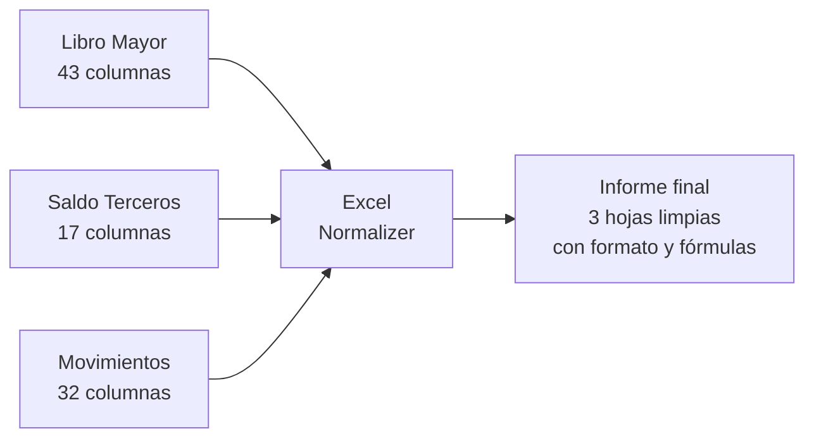
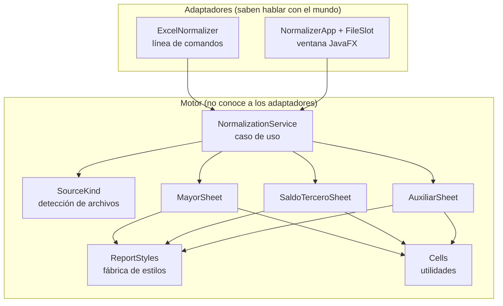
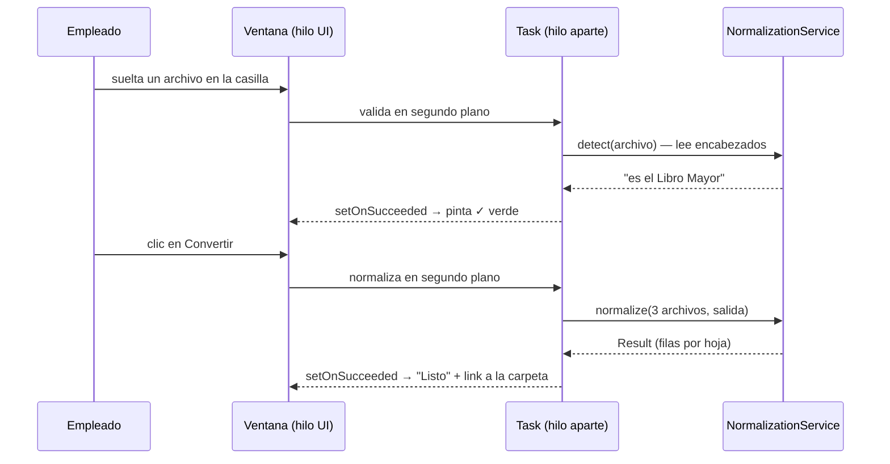
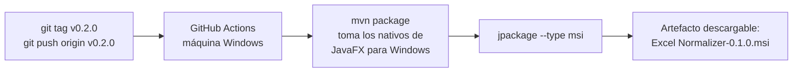

# Cómo funciona Excel Normalizer — guía de aprendizaje

Este documento explica, desde cero, todo lo que se construyó en este proyecto:
qué hace la aplicación, cómo se normaliza cada archivo, cómo se conecta la
interfaz con la lógica, qué capas existen, qué patrones de diseño se usaron y
cómo se genera el instalador de Windows. Está escrito para aprender, no solo
para consultar.

## El proyecto en una frase

El sistema contable del cliente exporta tres archivos de Excel "sucios" (con
decenas de columnas internas que nadie necesita), y esta aplicación los
convierte en un solo libro limpio, con el mismo formato, colores y fórmulas
del informe que el contador arma a mano cada mes.



---

## 1. La lógica de la normalización

### La idea común a los tres archivos

Piensa en cada export como una caja de mudanza revuelta: adentro hay cosas
valiosas mezcladas con papel de relleno. La normalización hace siempre lo
mismo:

1. **Lee los encabezados por NOMBRE, nunca por posición.** Si mañana el
   sistema contable agrega una columna en el medio, nada se rompe, porque
   buscamos "CODCTA" y no "la columna 12".
2. **Copia solo las columnas que el informe final necesita.**
3. **Agrega columnas derivadas como fórmulas de Excel vivas** (no valores
   pegados), igual que en el informe original del contador.
4. **Aplica los estilos exactos del informe de referencia**: colores, fuentes,
   bordes, formatos numéricos y anchos de columna.

### El concepto contable clave: el código de cuenta es un árbol

Todo gira alrededor del código de cuenta (`CODCTA`). Su longitud dice en qué
nivel del árbol está, y sus prefijos dicen a qué familia pertenece:

```
1        ACTIVO            (clase    — 1 dígito)
└─ 11      DISPONIBLE      (grupo    — 2 dígitos)
   └─ 1105   CAJA          (cuenta   — 4 dígitos)
      └─ 110505 CAJA GENERAL (subcuenta — 6 dígitos)
```

El código `110505` "lleva el apellido" de toda su familia: empieza con `1105`,
que empieza con `11`, que empieza con `1`. Por eso las columnas derivadas son
simples fórmulas de texto: `LEN` (¿cuántos dígitos tienes?) y `LEFT` (¿cuáles
son tus primeros 1, 2 o 4 dígitos?). Sirven para filtrar el informe por nivel.

### Hoja MAYOR (desde el export del Libro Mayor)

| Qué | Cómo |
|-----|------|
| Columnas copiadas | CODCTA, Tnomcta, ANTERIOR, DEBITOS, CREDITOS, SALDO_FINAL (6 de las 43) |
| Columnas derivadas | LARGO `=LEN`, N1 `=LEFT(,1)`, N2 `=LEFT(,2)`, N3 `=LEFT(,4)` |
| Encabezado del informe | Empresa, NIT, título y fechas salen de columnas del propio export (`lblNomCia`, `Nit`, `TITULO`, `dFecIni`, `dFecFin`) — el nombre de la empresa es un DATO, no está escrito en el código |
| Colores por nivel | 1–2 dígitos rojo negrita, 4 dígitos azul negrita, 6 dígitos negrita, 8 dígitos normal |
| Filas de control | PYG, PATRIMONIO, EC CONTABLE, PARTIDA DOBLE (ver abajo) |

**Las filas de control** son el "inspector" del contador: verifican que la
contabilidad cuadre. En el informe original estaban escritas con posiciones
fijas (`=+J121-J137...`), lo cual se rompe si las cuentas cambian de fila.
Nuestra versión **busca las filas de clase por su código** (los CODCTA de un
dígito) al momento de generar, y arma las fórmulas con las posiciones reales:

- `PYG` = Ingresos(4) − Gastos(5) − Costos ventas(6) − Costos producción(7)
- `PATRIMONIO` = Clase 3 + PYG
- `EC CONTABLE` = Activo(1) − Pasivo(2) − Patrimonio → **debe dar 0**
- `PARTIDA DOBLE` = suma de débitos − suma de créditos de todas las clases → **debe dar 0**

Si esos ceros no dan cero, el problema viene del sistema contable, y el
cliente lo ve antes de enviar el informe.

### Hoja SALDO TERCERO (desde el export de Saldos por Tercero)

Responde una pregunta distinta al MAYOR: no "cuánto hay en cada cuenta" sino
"**de quién** es lo que hay en cada cuenta" (cada fila tiene NIT y razón
social).

| Qué | Cómo |
|-----|------|
| Columnas copiadas | Código Cuenta, Nombre del Concepto, NIT_CEDULA, Razón Social, SALDO_ANTERIOR, DEBITOS, CREDITOS, SALDO_FINAL (reordenadas al orden del informe) |
| Columnas derivadas | N1 `=LEN`, N2 `=LEFT(,2)`, N3 `=LEFT(,4)` |
| Regla de color | Fila **sin NIT** = subtotal de cuenta → rojo negrita. Fila **con NIT** = detalle de una persona → normal |

Esa regla de color no fue inventada: se verificó contra las 988 filas del
informe original y se cumple sin excepciones. Así se descubre una regla de
negocio: mirando los datos, no adivinando.

### Hoja AUXILIAR (desde el export de Movimientos de Contabilidad)

Es el detalle máximo: un renglón por cada movimiento contable del período.

| Qué | Cómo |
|-----|------|
| Columnas copiadas | Las 20 columnas del movimiento (codcta, nomcta, FECHA, DEBITO, CREDITO, NIT, concepto, etc.) |
| Columnas derivadas | N1/N2/N3 adelante, y al final **NETO** `=DEBITO−CREDITO` por fila |
| Nota | La tabla dinámica "TD anual" del informe original se alimenta de esta hoja; se decidió NO generarla — el contador refresca la suya apuntándola al archivo nuevo |

---

## 2. Las capas y sus responsabilidades

La regla de oro: **el motor no sabe cómo lo invocan**. Piensa en un
restaurante: la cocina (motor) prepara el plato igual sin importar si el
pedido llegó por un mesero o por una app de domicilios (adaptadores).



| Clase | Responsabilidad (una sola) |
|-------|---------------------------|
| `NormalizationService` | Orquestar: detectar los 3 archivos, invocar los 3 escritores, guardar el resultado. Falla con excepciones, jamás cierra el proceso |
| `SourceKind` | Saber reconocer cada export por sus encabezados |
| `MayorSheet` / `SaldoTerceroSheet` / `AuxiliarSheet` | Escribir UNA hoja cada una: columnas, fórmulas, estilos |
| `ReportStyles` | Crear los estilos de celda (una sola vez, se reutilizan) |
| `Cells` | Ayudantes pequeños: leer encabezados, copiar valores de celda |
| `ExcelNormalizer` (CLI) | Traducir argumentos → servicio → mensajes de consola y códigos de salida. Es el ÚNICO lugar con `System.exit` |
| `NormalizerApp` / `FileSlot` (UI) | Traducir clics y arrastres → servicio → etiquetas y colores en pantalla |

¿Por qué importa? Porque cuando el cliente pidió "ya no web, ahora
escritorio", **el motor no cambió ni una línea**. Solo se agregó un adaptador
nuevo (la ventana). Y si mañana vuelve a pedir web, será otro adaptador más.

---

## 3. Cómo la UI se conecta con la lógica

### El hilo de la interfaz (el concepto MÁS importante de JavaFX)

JavaFX dibuja toda la ventana con **un solo hilo**. Si en ese hilo lees un
Excel de 4.500 filas, la ventana se congela y el usuario cree que el programa
murió. La solución: el trabajo pesado corre en un hilo aparte (`Task`), y al
terminar se vuelve al hilo de la UI para pintar el resultado.



### La validación en las casillas

Cada casilla espera UN tipo de archivo (orden guiado), pero no confía a
ciegas: cuando el empleado carga un archivo, la app lee sus encabezados con
`NormalizationService.detect()` y, si no corresponde, lo dice ahí mismo:
*"Este archivo parece ser Movimientos de Contabilidad, no Libro Mayor"*.
Pedir orden es la guía; detectar es el cinturón de seguridad.

---

## 4. Patrones de diseño usados (y POR QUÉ)

Un patrón no se usa "porque sí": se usa cuando resuelve un problema real que
tienes enfrente.

| Patrón | Dónde está | Qué problema resuelve aquí |
|--------|-----------|---------------------------|
| **Fachada (Facade)** | `NormalizationService.normalize()` | La UI y el CLI necesitan "conviérteme esto" sin conocer POI, hojas ni estilos. Una sola puerta de entrada simple a un subsistema complejo |
| **Puertos y Adaptadores (arquitectura hexagonal, versión ligera)** | Motor vs. `ui`/CLI | Poder cambiar el mecanismo de entrega (web → escritorio) sin tocar la lógica. Ya se comprobó en la práctica |
| **Estrategia vía polimorfismo de enum** | `SourceKind.matches()` | Cada tipo de export sabe reconocerse a sí mismo. Agregar un cuarto export = agregar un valor al enum, sin tocar ningún `if` gigante |
| **Fábrica (Factory)** | `ReportStyles` | Los estilos de celda en POI pertenecen al libro y son limitados: deben crearse UNA vez y reutilizarse. La fábrica centraliza esa regla |
| **Objeto de Valor (record)** | `NormalizationService.Result` | Devolver un resultado inmutable con nombre claro, en vez de un arreglo mágico de números |
| **Observador (Observer)** | `setOnAction`, `setOnSucceeded` en JavaFX | La UI reacciona a eventos (clics, tareas terminadas) sin preguntar en bucle "¿ya terminaste?" |
| **Composición sobre herencia** | Los 3 escritores de hoja NO heredan de una clase padre | Se parecen, pero sus diferencias (títulos, filas de control, regla de NIT) son mayores que lo compartido. Forzar herencia habría creado un padre confuso. Lo común se extrajo a `Cells` y `ReportStyles` |

**Nota honesta**: `MayorSheet`, `SaldoTerceroSheet` y `AuxiliarSheet` repiten
una estructura similar (validar columnas → encabezado → filas → anchos). Si
apareciera un cuarto o quinto tipo de hoja, ahí sí valdría la pena extraer un
**Método Plantilla (Template Method)**. Con tres, la duplicación es más barata
que la abstracción equivocada.

---

## 5. Buenas prácticas aplicadas

- **Leer por nombre de encabezado, no por posición** → resiste cambios del
  sistema origen.
- **Fallar rápido y con mensajes claros**: si falta una columna o dos archivos
  son el mismo export, se detiene con un mensaje entendible, no con un Excel
  corrupto ni un stack trace.
- **Excepciones en el motor, `System.exit` solo en el CLI**: una librería que
  mata el proceso es una librería que nadie puede reutilizar.
- **El nombre del cliente es un dato, no código**: el paquete se llama
  `com.excelnormalizer` (no `com.agroyuca`) y la empresa del informe sale del
  propio archivo. La herramienta sirve para cualquier empresa.
- **YAGNI (You Aren't Gonna Need It)**: no se generó la tabla dinámica (el
  contador refresca la suya), no se separó en módulos Maven (un solo consumidor
  extra no lo justifica aún), no se creó base de datos ni servidor. Cada "no"
  fue una decisión, no un olvido.
- **Verificar contra la realidad**: cada regla (colores por nivel, rojo sin
  NIT, fórmulas de control) se comprobó celda por celda contra el informe
  original antes de programarla.
- **Datos sensibles fuera del repositorio**: el `.gitignore` bloquea todos los
  `.xlsx` — cédulas, nombres y saldos del cliente jamás viajan a GitHub.
- **Trabajo pesado fuera del hilo de la UI**: la ventana nunca se congela.
- **Commits convencionales y versiones con tags** (`v0.1.0`): historia legible
  y releases reproducibles.

---

## 6. Del código al instalador de Windows (.msi)

El objetivo: que el empleado haga doble clic y ya — sin instalar Java, sin
terminal, sin comandos.

**La herramienta es `jpackage`** (viene con el JDK): empaqueta la aplicación
junto con un Java recortado a la medida, y produce un instalador nativo. El
empleado ve "Siguiente → Siguiente → Instalar" y le queda un acceso directo.

**El problema: `jpackage` no cross-compila.** Desde macOS no se puede generar
un `.msi` de Windows. Soluciones en el proyecto:

| Camino | Cuándo usarlo |
|--------|--------------|
| `scripts/package-windows.bat` en una máquina Windows (necesita JDK 25, Maven y WiX v3) | Si tienes una PC o VM con Windows a mano |
| GitHub Actions (`.github/workflows/package-windows.yml`) | Sin máquina Windows: GitHub presta una |

**El flujo automatizado** funciona así:



Detalle importante: el jar incluye los archivos nativos de JavaFX **de la
plataforma donde se compila**. Por eso el workflow compila TODO en Windows,
no solo el paso final.

**Advertencia de confianza**: un `.msi` sin firmar dispara el aviso de
SmartScreen la primera vez ("Windows protegió tu equipo"). Para pocos
empleados se explica una vez; para cero avisos se necesita un certificado de
firma de código (decisión y costo del cliente).

---

## Para seguir aprendiendo

- [ ] Abre `NormalizationService` y sigue el camino de `normalize()` hasta una
      celda escrita: verás pasar todas las capas.
- [ ] Rompe algo a propósito: cambia un encabezado en un Excel de prueba y
      observa el mensaje de error. Así se siente el "fallar rápido".
- [ ] Agrega un cuarto `SourceKind` imaginario y nota cuántos archivos tocas
      (spoiler: casi ninguno). Eso es el patrón Estrategia trabajando.
- [ ] Lee sobre arquitectura hexagonal (puertos y adaptadores) — este proyecto
      es una versión en miniatura y real de esa idea.
